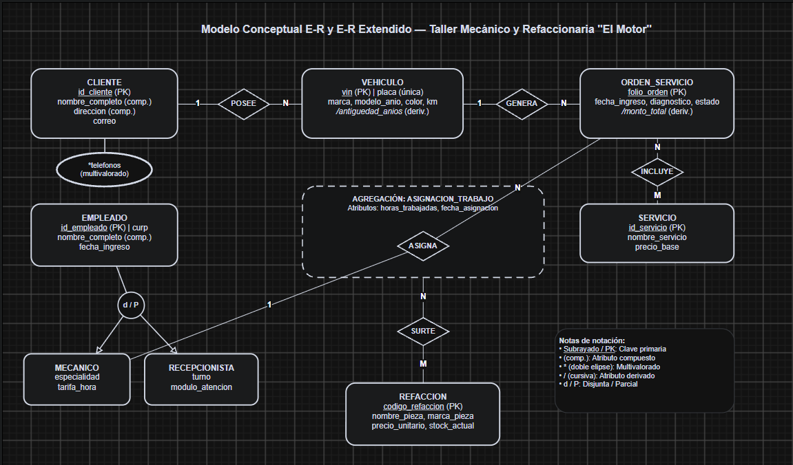

# Tarea 2.1 — Modelado conceptual E-R y E-R Extendido

**Unidad:** Unidad 2 — Diseño de Bases de Datos con el modelo E-R  
**Caso de estudio:** Taller Mecánico y Refaccionaria "El Motor"

## Descripción del proyecto
Diseño conceptual del sistema de información para el Taller Mecánico y Refaccionaria "El Motor" a partir de su problemática real, reglas de negocio, estructura de entidades y atributos, relaciones con cardinalidades y restricciones de participación, así como elementos del modelo Entidad-Relación Extendido (E-RE) y su representación formal en herramienta CASE.

## Entregables en esta carpeta
- `Reporte_Tecnico_Tarea_2_1_ER-v2.pdf`: Reporte técnico con el planteamiento del problema, reglas de negocio, diagrama E-R/E-RE en alta resolución y justificación de diseño.
- `diagrama_er_extendido_el_motor.drawio`: Archivo fuente editable del diagrama elaborado en herramienta CASE[cite: 4].
- `diagrama_er_extendido_el_motor.png`: Exportación en imagen del diagrama E-R extendido[cite: 4].

## Vista previa del diagrama

## Video explicativo (YouTube)
- Enlace al video: *(Agregar aquí el enlace público del video una vez publicado en YouTube)*
