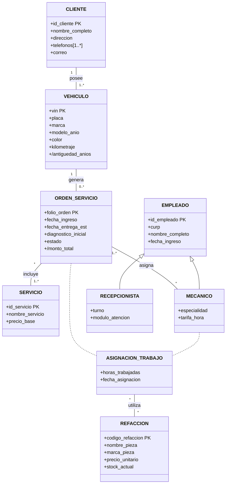

# Tarea 2.1: Modelado conceptual E-R y E-R Extendido

**Caso:** Taller Mecánico y Refaccionaria "El Motor"
**Tec Monclova · Ingeniería en Sistemas Computacionales**
**Unidad 2:** Diseño de Bases de Datos con el modelo E-R

**Alumno:** Cristofer Alejandro Barboza Chávez
**No. de control:** I24050398

---

## Enlaces

- 🎥 **Video en YouTube:** [pegar enlace del video]
- 📄 **Reporte técnico (PDF):** [Reporte_Tecnico_Tarea_2_1_ER-v3.pdf](Reporte_Tecnico_Tarea_2_1_ER-v3.pdf)
- 🧩 **Archivo fuente del diagrama (draw.io):** [diagrama_ER_ElMotor.drawio](diagrama_ER_ElMotor.drawio)
- 🖼️ **Diagrama en imagen:** [diagrama_ER_ElMotor.png](diagrama_ER_ElMotor.png)
- 📑 **Diagrama en PDF:** [diagrama_ER_ElMotor.pdf](diagrama_ER_ElMotor.pdf)

---

## Descripción

El taller "El Motor" (Monclova, Coahuila) lleva el control de clientes, vehículos, órdenes de servicio, personal y refacciones en libretas y hojas sueltas. Este proyecto propone el diseño conceptual de la base de datos con el modelo Entidad-Relación y Entidad-Relación Extendido (especialización y agregación).

## Resumen del modelo (notación UML)

Resumen en UML (diagrama de clases con Mermaid, que GitHub muestra automáticamente). El diagrama E-R formal está en el archivo `.drawio` y en el reporte.

## Conceptos del E-R extendido aplicados

- **Especialización:** EMPLEADO → MECANICO, RECEPCIONISTA (total y disjunta).
- **Agregación:** la asignación orden–mecánico se relaciona con REFACCION.
- **Atributos:** claves, compuestos, multivalorados y derivados.
- **Participación:** total y parcial.

## Herramientas

- draw.io (diagrams.net) como herramienta CASE
- OBS Studio para el video
