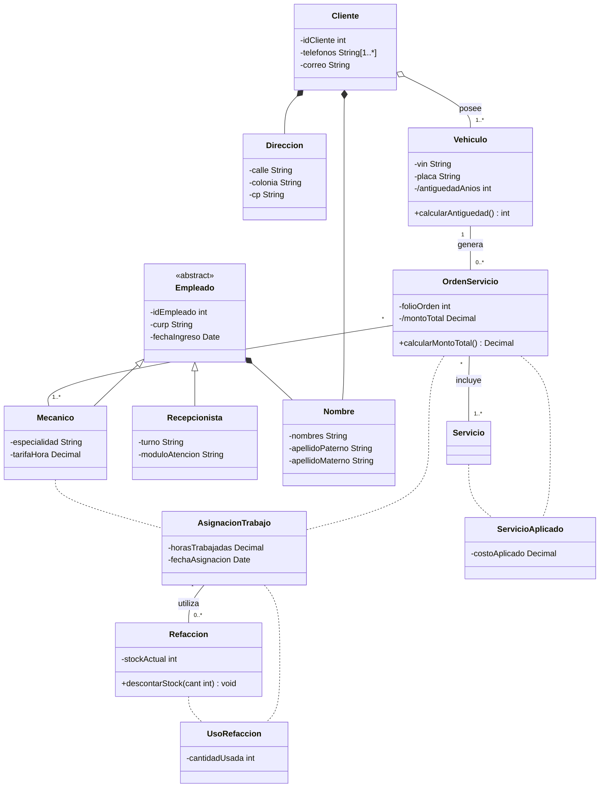

# Tarea 2.2: Transición de diagrama E-R a notación UML

**Caso:** Taller Mecánico y Refaccionaria "El Motor"
**Tec Monclova · Ingeniería en Sistemas Computacionales**
**Unidad 2:** Diseño de Bases de Datos con el modelo E-R

**Alumno:** Cristofer Alejandro Barboza Chávez
**No. de control:** I24050398

---

## Enlaces

- 🎥 **Video en YouTube:** [pegar enlace del video]
- 📄 **Documento comparativo E-R vs. UML (PDF):** [Reporte_Tarea_2_2_ER_vs_UML.pdf](Reporte_Tarea_2_2_ER_vs_UML.pdf)
- 🧩 **Diagrama UML editable (draw.io):** [diagrama_UML_ElMotor.drawio](diagrama_UML_ElMotor.drawio)
- 🖼️ **Diagrama UML en imagen:** [diagrama_UML_ElMotor.png](diagrama_UML_ElMotor.png)
- 📑 **Diagrama UML en PDF:** [diagrama_UML_ElMotor.pdf](diagrama_UML_ElMotor.pdf)
- ⬅️ **Tarea 2.1 (diagrama E-R de origen):** [pegar enlace a la carpeta de la tarea 2.1]

---

## Descripción

Conversión del diagrama conceptual E-R / E-RE del taller "El Motor" a un diagrama de clases UML, con la correspondencia directa entre entidades y clases, atributos y propiedades, y relaciones y asociaciones (composición, agregación y herencia).

## Correspondencia E-R → UML

| Modelo E-R / E-RE | UML |
|---|---|
| Entidad | Clase |
| Atributo / clave primaria | Propiedad / `{id}` |
| Atributo compuesto | Clase de valor + composición |
| Atributo multivalorado | Propiedad con multiplicidad `[1..*]` |
| Atributo derivado | `/propiedad` + operación que la calcula |
| Relación 1:N y M:N | Asociación con multiplicidades |
| Relación con atributos / agregación | Clase de asociación |
| Especialización total y disjunta | Herencia `{complete, disjoint}` |
| Participación total / parcial | Multiplicidad mínima 1 / 0 |

## Resumen del modelo (UML)

## Herramientas

- draw.io (diagrams.net) como herramienta CASE
- OBS Studio para el video
