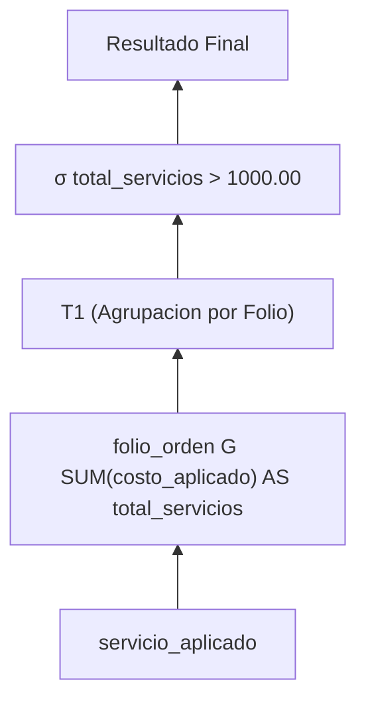
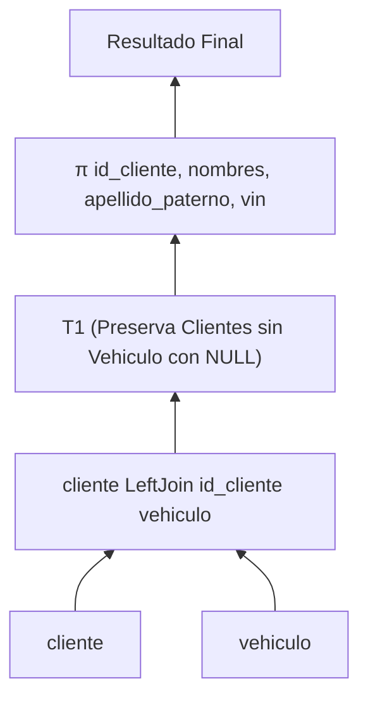
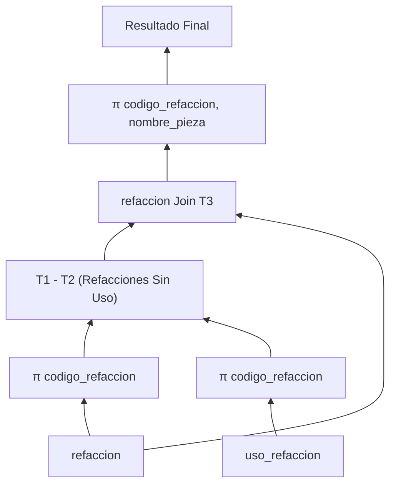
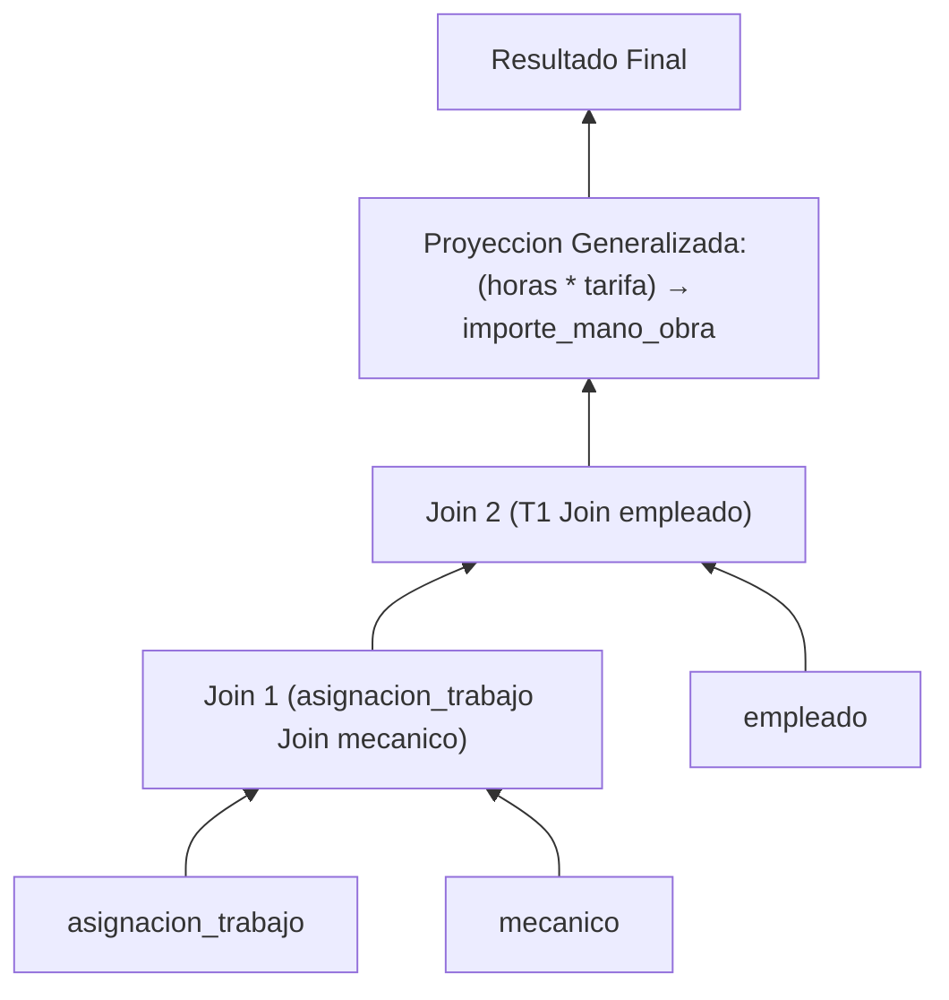

# Unidad 5: Álgebra Relacional

## Tarea 5.2: Resolución de Consultas sobre el Esquema Relacional con Álgebra Formal

* **Institución:** Instituto Tecnológico de Monclova
* **Carrera:** Ingeniería en Sistemas Computacionales
* **Alumno:** Cristofer Alejandro Barboza Chávez
* **Matrícula:** 124050398
* **Caso de Estudio:** Taller Mecánico y Refaccionaria "El Motor"

---

## Catálogo de 10 Consultas Formales

### Consulta 1 (Básica — Selección y Proyección)

* **Requerimiento:** Obtener VIN, placa, marca y año del modelo de vehículos registrados con kilometraje mayor a 80,000 km.

* **Álgebra Relacional:**

$$\pi_{\text{vin}, \text{placa}, \text{marca}, \text{modelo\_anio}}\big(\sigma_{\text{kilometraje} > 80000}(\text{vehiculo})\big)$$

* **Tablas Intermedias:**
  1. $T_1 = \sigma_{\text{kilometraje} > 80000}(\text{vehiculo})$
  2. $\text{Resultado} = \pi_{\text{vin}, \text{placa}, \text{marca}, \text{modelo\_anio}}(T_1)$

---

### Consulta 2 (Básica — Filtro de Catálogo)

* **Requerimiento:** Listar código, nombre de pieza y precio unitario de las refacciones con precio menor o igual a \$500.00.

* **Álgebra Relacional:**

$$\pi_{\text{codigo\_refaccion}, \text{nombre\_pieza}, \text{precio\_unitario}}\big(\sigma_{\text{precio\_unitario} \le 500.00}(\text{refaccion})\big)$$

* **Tablas Intermedias:**
  1. $T_1 = \sigma_{\text{precio\_unitario} \le 500.00}(\text{refaccion})$
  2. $\text{Resultado} = \pi_{\text{codigo\_refaccion}, \text{nombre\_pieza}, \text{precio\_unitario}}(T_1)$

---

### Consulta 3 (Intermedia — Join Triple)

* **Requerimiento:** Mostrar folio de orden, estado, placa del vehículo y nombre completo del cliente para cada orden.

* **Álgebra Relacional:**

$$\pi_{\text{folio\_orden}, \text{estado}, \text{placa}, \text{nombres}, \text{apellido\_paterno}, \text{apellido\_materno}}\Big((\text{orden\_servicio} \bowtie_{\text{vin}} \text{vehiculo}) \bowtie_{\text{id\_cliente}} \text{cliente}\Big)$$

* **Tablas Intermedias:**
  1. $T_1 = \text{orden\_servicio} \bowtie_{\text{vin}} \text{vehiculo}$
  2. $T_2 = T_1 \bowtie_{\text{id\_cliente}} \text{cliente}$
  3. $\text{Resultado} = \pi_{\text{folio\_orden}, \text{estado}, \text{placa}, \text{nombres}, \text{apellido\_paterno}, \text{apellido\_materno}}(T_2)$

---

### Consulta 4 (Intermedia — Join + Desigualdad)

* **Requerimiento:** Obtener folio de orden, ID de servicio, nombre del servicio y costo aplicado donde el precio cobrado difiera del precio base del catálogo.

* **Álgebra Relacional:**

$$\pi_{\text{folio\_orden}, \text{id\_servicio}, \text{nombre\_servicio}, \text{costo\_aplicado}}\Big(\sigma_{\text{costo\_aplicado} \neq \text{precio\_base}}(\text{servicio\_aplicado} \bowtie_{\text{id\_servicio}} \text{servicio})\Big)$$

* **Tablas Intermedias:**
  1. $T_1 = \text{servicio\_aplicado} \bowtie_{\text{id\_servicio}} \text{servicio}$
  2. $T_2 = \sigma_{\text{costo\_aplicado} \neq \text{precio\_base}}(T_1)$
  3. $\text{Resultado} = \pi_{\text{folio\_orden}, \text{id\_servicio}, \text{nombre\_servicio}, \text{costo\_aplicado}}(T_2)$

---

### Consulta 5 (Intermedia — Especialización)

* **Requerimiento:** Listar ID de empleado, CURP, nombres, especialidad y tarifa por hora de los mecánicos.

* **Álgebra Relacional:**

$$\pi_{\text{id\_empleado}, \text{curp}, \text{nombres}, \text{especialidad}, \text{tarifa\_hora}}(\text{empleado} \bowtie_{\text{id\_empleado}} \text{mecanico})$$

* **Tablas Intermedias:**
  1. $T_1 = \text{empleado} \bowtie_{\text{id\_empleado}} \text{mecanico}$
  2. $\text{Resultado} = \pi_{\text{id\_empleado}, \text{curp}, \text{nombres}, \text{especialidad}, \text{tarifa\_hora}}(T_1)$

---

### Consulta 6 (Intermedia — Agregación)

* **Requerimiento:** Calcular por mecánico (`id_mecanico`) el total de horas trabajadas y la cantidad de órdenes asignadas.

* **Álgebra Relacional:**

$$_{id\_mecanico}\mathcal{G}_{\text{SUM}(\text{horas\_trabajadas}) \text{ AS total\_horas},\; \text{COUNT}(\text{folio\_orden}) \text{ AS num\_ordenes}}(\text{asignacion\_trabajo})$$

---

### Consulta 7 (Compleja — Agregación + Filtro)

* **Requerimiento:** Obtener el folio de orden y el monto acumulado en servicios para órdenes que superen los \$1,000.00.

* **Álgebra Relacional:**

$$\sigma_{\text{total\_servicios} > 1000.00}\Big(_{folio\_orden}\mathcal{G}_{\text{SUM}(\text{costo\_aplicado}) \text{ AS total\_servicios}}(\text{servicio\_aplicado})\Big)$$

**Árbol de Ejecución (UML Flowchart):**

---

### Consulta 8 (Compleja — Left Outer Join)

* **Requerimiento:** Listar todos los clientes con el VIN de sus vehículos, incluyendo a aquellos clientes sin vehículo registrado.

* **Álgebra Relacional:**

$$\pi_{\text{id\_cliente}, \text{nombres}, \text{apellido\_paterno}, \text{vin}}(\text{cliente} \mathbin{\text{⟕}}_{\text{id\_cliente}} \text{vehiculo})$$

**Árbol de Ejecución (UML Flowchart):**

---

### Consulta 9 (Compleja — Diferencia de Conjuntos)

* **Requerimiento:** Obtener código y nombre de las refacciones del catálogo que nunca han sido utilizadas.

* **Álgebra Relacional:**

$$\pi_{\text{codigo\_refaccion}, \text{nombre\_pieza}}\Big(\text{refaccion} \bowtie \big(\pi_{\text{codigo\_refaccion}}(\text{refaccion}) - \pi_{\text{codigo\_refaccion}}(\text{uso\_refaccion})\big)\Big)$$

**Árbol de Ejecución (UML Flowchart):**

---

### Consulta 10 (Compleja — Join Múltiple + Proyección Generalizada)

* **Requerimiento:** Calcular el importe total de mano de obra ($\text{horas\_trabajadas} \times \text{tarifa\_hora}$) por mecánico y por orden.

* **Álgebra Relacional:**

$$\pi_{\text{folio\_orden}, \text{id\_mecanico}, \text{nombres}, (\text{horas\_trabajadas} \times \text{tarifa\_hora}) \rightarrow \text{importe\_mano\_obra}}\Big((\text{asignacion\_trabajo} \bowtie_{\text{id\_mecanico} = \text{id\_empleado}} \text{mecanico}) \bowtie_{\text{id\_empleado}} \text{empleado}\Big)$$

**Árbol de Ejecución (UML Flowchart):**

---

## Entregables en Teams

| Entregable | Estado / Enlace | 
| :--- | :--- | 
| **1. PDF:** Reporte técnico del catálogo y validaciones | `Tarea_5_2_Consultas_Algebra.pdf` | 
| **2. GitHub:** Archivo Markdown y script `taller_el_motor_relax.txt` | `README_5.2.md` | 
| **3. YouTube:** Video explicando C7, C8 y C10 (webcam en esquina inferior derecha) | `[Pegar Enlace Público de YouTube Aquí]` | 