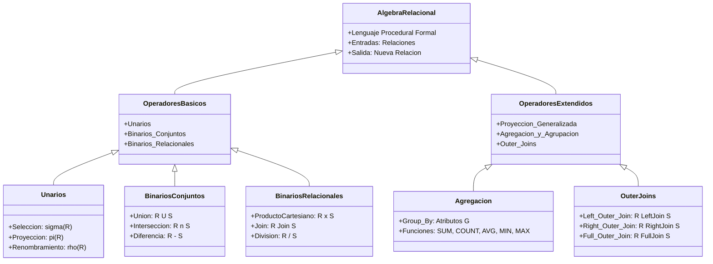

# Unidad 5: Álgebra Relacional
## Tarea 5.1: Operadores Fundamentales y Extendidos del Álgebra Relacional

* **Institución:** Instituto Tecnológico de Monclova
* **Carrera:** Ingeniería en Sistemas Computacionales
* **Alumno:** Cristofer Alejandro Barboza Chávez
* **Matrícula:** 124050398
* **Caso de Estudio:** Taller Mecánico y Refaccionaria "El Motor"

---

## 1. Marco Teórico Formal

El **álgebra relacional** es un lenguaje de consulta procedural formal ideado por E. F. Codd. Opera sobre una o más relaciones (tablas) de entrada y produce una nueva relación como resultado. Sirve como fundamento matemático para la construcción y optimización de consultas en los Sistemas Gestores de Bases de Datos Relacionales (SGBD).

---

## 2. Definición y Notación Formal de Operadores

### 2.1 Operadores Unarios

| Operador | Símbolo | Notación Formal | Comportamiento Procedural |
| :--- | :---: | :---: | :--- |
| **Selección** | $\sigma$ | $\sigma_{\theta}(R)$ | Filtra horizontalmente las tuplas que satisfacen la condición booleana $\theta$. |
| **Proyección** | $\pi$ | $\pi_{A_1, \dots, A_k}(R)$ | Extrae verticalmente las columnas $A_1, \dots, A_k$ eliminando duplicados. |
| **Renombramiento** | $\rho$ | $\rho_{S(B_1, \dots, B_n)}(R)$ | Modifica el nombre de la relación $R$ a $S$ y/o renombra sus atributos. |

### 2.2 Operadores Binarios de Conjuntos

Requieren que las relaciones $R$ y $S$ sean **compatibles en esquema** (mismo grado y dominios de atributos compatibles).

| Operador | Símbolo | Notación Formal | Comportamiento Procedural |
| :--- | :---: | :---: | :--- |
| **Unión** | $\cup$ | $R \cup S$ | Tuplas pertenecientes a $R$, a $S$, o a ambas. |
| **Intersección** | $\cap$ | $R \cap S$ | Tuplas presentes simultáneamente en $R$ y en $S$. |
| **Diferencia** | $-$ | $R - S$ | Tuplas presentes en $R$ pero no en $S$ (negación lógica). |

### 2.3 Operadores Binarios Relacionales

| Operador | Símbolo | Notación Formal | Comportamiento Procedural |
| :--- | :---: | :---: | :--- |
| **Producto Cartesiano** | $\times$ | $R \times S$ | Combina cada tupla de $R$ con cada tupla de $S$ ($|R| \times |S|$ tuplas). |
| **Reunión (Join)** | $\bowtie$ | $R \bowtie_{\theta} S$ | Equivale a $\sigma_{\theta}(R \times S)$. Acopla tuplas según la condición $\theta$. |
| **División** | $\div$ | $R \div S$ | Obtiene las tuplas de $R(A,B)$ asociadas con **todas** las tuplas de $S(B)$. |

### 2.4 Operadores del Álgebra Relacional Extendida

| Operador | Notación Formal | Comportamiento Procedural |
| :--- | :---: | :--- |
| **Proyección Generalizada** | $\pi_{F_1, \dots, F_k}(R)$ | Permite incluir expresiones aritméticas, transformaciones y alias en los atributos. |
| **Agregación y Agrupación** | $_{G}\mathcal{G}_{F_1(A_1), \dots, F_m(A_m)}(R)$ | Agrupa por $G$ y calcula funciones ($\text{SUM}$, $\text{COUNT}$, $\text{AVG}$, $\text{MIN}$, $\text{MAX}$). |
| **Left Outer Join** | $R \mathbin{\text{⟕}}_{\theta} S$ | Preserva tuplas de $R$; si no hay pareja en $S$, rellena con $\text{NULL}$. |
| **Right Outer Join** | $R \mathbin{\text{⟖}}_{\theta} S$ | Preserva tuplas de $S$; si no hay pareja en $R$, rellena con $\text{NULL}$. |
| **Full Outer Join** | $R \mathbin{\text{⟗}}_{\theta} S$ | Preserva todas las tuplas de $R$ y $S$, rellenando con $\text{NULL}$ las ausencias. |

---

## 3. Mapa Conceptual de Operadores en UML (Mermaid)

---

## 4. Entregables en Teams

| Entregable | Estado / Enlace |
| :--- | :--- |
| **1. PDF:** Informe técnico con marco teórico y mapa conceptual | `Tarea_5_1_Algebra_Relacional.pdf` |
| **2. GitHub:** Archivo Markdown fuente | `README_5.1.md` |
| **3. YouTube:** Video de notación formal (webcam abajo a la derecha) | `[Pegar Enlace Público de YouTube Aquí]` |